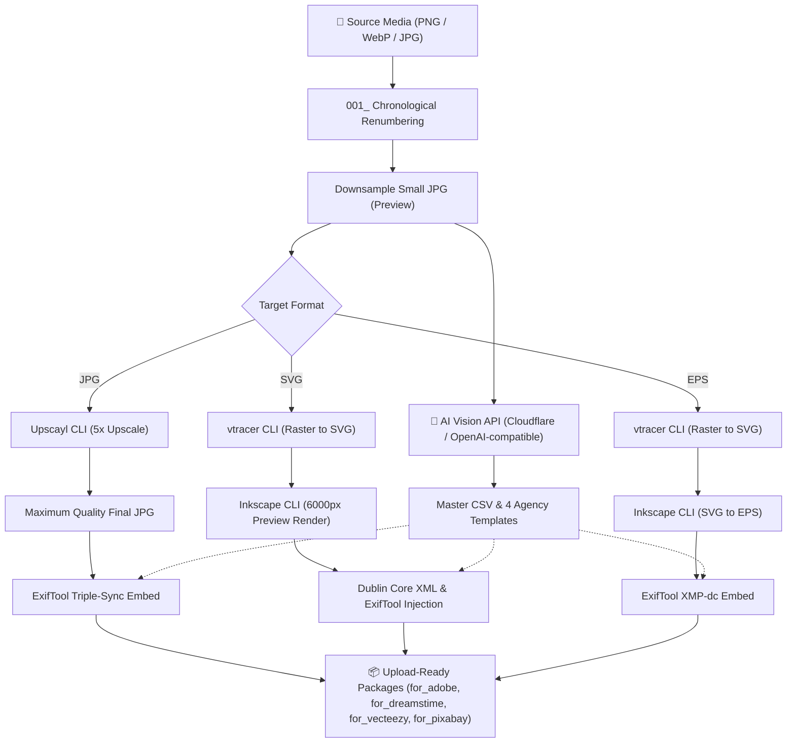

# Microstock Helper

[](https://github.com/alamaby/microstock-helper/releases)
[](https://www.python.org/downloads/)
[](https://www.microsoft.com/windows)
[](LICENSE)
[](tests/)

A unified Python-based microstock workflow automation CLI for raster image processing, SVG/EPS vectorization, AI metadata generation via Vision API, and metadata embedding compliant with major stock agency standards (**Adobe Stock**, **Dreamstime**, **Vecteezy**, and **Pixabay**).

---

## Table of Contents

- [Workflow](#workflow)
- [Key Features](#key-features)
- [Prerequisites & External Dependencies](#prerequisites--external-dependencies)
- [Quick Installation Guide](#quick-installation-guide)
- [System Readiness Diagnostic (`doctor`)](#system-readiness-diagnostic-doctor)
- [CLI Usage Guide](#cli-usage-guide)
  - [1. End-to-End Orchestrator (`run`)](#1-end-to-end-orchestrator-run)
  - [2. Batch Processing Metadata & Embed (`batch`)](#2-batch-processing-metadata--embed-batch)
  - [3. Standalone AI Metadata Generation (`generate`)](#3-standalone-ai-metadata-generation-generate)
  - [4. Raster to JPG Conversion (`convert`)](#4-raster-to-jpg-conversion-convert)
  - [5. Chronological Renumbering (`renumber`)](#5-chronological-renumbering-renumber)
  - [6. AI Image Upscaling (`upscale`)](#6-ai-image-upscaling-upscale)
  - [7. SVG Vector Tracing (`trace`)](#7-svg-vector-tracing-trace)
  - [8. Vector Preview Rendering (`vector-preview`)](#8-vector-preview-rendering-vector-preview)
  - [9. SVG to EPS Conversion (`convert-eps`)](#9-svg-to-eps-conversion-convert-eps)
  - [10. Image Metadata Embedding (`embed-jpg`)](#10-image-metadata-embedding-embed-jpg)
  - [11. Vector Package Metadata Embedding (`embed-vector`)](#11-vector-package-metadata-embedding-embed-vector)
- [Agency Requirements & Format Matrix](#agency-requirements--format-matrix)
- [Output Directory Structure](#output-directory-structure)
- [Verification & Testing](#verification--testing)
- [License](#license)

---

## Workflow



---

## Key Features

- 🔍 **Startup Preflight Check**: Automatic dependency validation on launch; verifies availability of all external CLI binaries and API keys before executing any pipeline tasks.
- ⚡ **Native Pillow Processing**: Pure Python raster format conversions (PNG, WebP, TIF, BMP to JPEG) without heavy external subprocess overhead, including alpha compositing onto standard stock-photo solid white backgrounds.
- 🧠 **Multi-Tier Vision Metadata AI with Auto-Rotation**: Generates compliant titles, descriptions, keywords (phrases & single-words), and agency categories. Supports Cloudflare Workers AI with multi-account/multi-token round-robin rotation, dynamic endpoint formatting, quota circuit breakers (HTTP 429), and fallback to local OpenAI-compatible gateways.
- 🔄 **End-to-End Orchestrator & Smart Resume**: Multi-stage pipeline (Stages 0–7) with per-item idempotency and atomic checkpointing (`checkpoint.json`), allowing seamless resumption without re-invoking the Vision API or re-processing completed files.
- 🛡️ **Windows MAX_PATH (260 Characters) Bypass**: Safe Upscayl CLI execution via sandboxed short paths in `%TEMP%` to prevent path-length errors.
- 🏷️ **Two-Phase Triple-Sync ExifTool**: Clean metadata injection (reset phase followed by clean UTF-8 write phase) across IPTC, XMP, and EXIF to prevent tag duplication and ensure 100% readability across all agency portals.

---

## Prerequisites & External Dependencies

The application runs in a **Windows** environment and utilizes the following CLI tools:

| CLI Tool | Primary Function | Default Search Paths |
|---|---|---|
| **Python** (>= 3.10) | Core application runtime & Pillow raster ops | System `PATH` |
| **ExifTool** | Metadata embedding for JPG, PNG, and PostScript EPS | `C:\Apps\exiftool\exiftool.exe` or `PATH` |
| **Upscayl CLI** | AI Image Upscaling (`upscayl-standard-4x` model) | `C:\Program Files\Upscayl\resources\bin\upscayl-bin.exe` |
| **vtracer CLI** | Raster JPG to SVG spline curve tracing | `C:\Apps\vtracer.exe` or `PATH` |
| **Inkscape CLI** | 6000px JPG preview rendering & SVG to EPS conversion | `C:\Program Files\Inkscape\bin\inkscape.com` or `PATH` |
| **ffmpeg / ffprobe** | Video frame extraction & media stream probing | `C:\ProgramData\chocolatey\bin\ffmpeg.exe` or `PATH` |

> [!NOTE]
> If any tool is installed in a non-standard directory, you can override its path via environment variables:
> - `MICROSTOCK_EXIFTOOL_PATH`
> - `MICROSTOCK_UPSCAYL_PATH`
> - `MICROSTOCK_VTRACER_PATH`
> - `MICROSTOCK_INKSCAPE_PATH`
> - `MICROSTOCK_FFMPEG_PATH`
> - `MICROSTOCK_FFPROBE_PATH`

---

## Quick Installation Guide

### 1. Automated Setup

Run the one-click setup script in the root directory to create the virtual environment and install all Python dependencies:

```cmd
setup.bat
```

### 2. Configure API Credentials

Copy the environment template to `.env` in the root repository:

```cmd
copy .env.example .env
```

Configure your Vision API credentials in `.env`:

```env
# ------------------------------------------------------------------------------
# Primary Provider: Cloudflare Workers AI (Multi-Account / Key Rotation)
# ------------------------------------------------------------------------------
# Option A: Single Account
MICROSTOCK_CF_ACCOUNT_ID=your_cloudflare_account_id_here
MICROSTOCK_CF_API_TOKEN=your_cloudflare_api_token_here

# Option B: Multi-Account Credential Pairs (Auto-rotation & Quota Circuit Breaker)
# MICROSTOCK_CF_ACCOUNTS=account_id_1:api_token_1,account_id_2:api_token_2

# Model Vision (Default: @cf/meta/llama-4-scout-17b-16e-instruct)
MICROSTOCK_CF_MODEL=@cf/meta/llama-4-scout-17b-16e-instruct

# ------------------------------------------------------------------------------
# Secondary Provider: Local Gateway / OpenCode (Fallback)
# ------------------------------------------------------------------------------
MICROSTOCK_API_KEY=your_api_key_here
MICROSTOCK_API_ENDPOINT=http://127.0.0.1:20128/v1
MICROSTOCK_API_MODEL=oc/mimo-v2.6-flash-free
```

---

## System Readiness Diagnostic (`doctor`)

Run the diagnostic tool to verify all Python dependencies, CLI binaries, and API configurations:

```cmd
run.bat doctor
```

Example diagnostic output:

```text
============================================================
  MICROSTOCK SYSTEM DIAGNOSTIC (DOCTOR)
============================================================
  Python                   : OK 3.14.3 (>= 3.10)
  Package PIL              : OK
  Package pydantic         : OK
  Package yaml             : OK

  [External CLI Tools]
  exiftool                 : OK  C:\Apps\exiftool\exiftool.exe
  upscayl                  : OK  C:\Program Files\Upscayl\resources\bin\upscayl-bin.exe
  vtracer                  : OK  C:\Apps\vtracer.EXE
  inkscape                 : OK  C:\Program Files\Inkscape\bin\inkscape.com
  ffmpeg                   : OK  C:\ProgramData\chocolatey\bin\ffmpeg.exe
  ffprobe                  : OK  C:\ProgramData\chocolatey\bin\ffprobe.exe

  [API Key Configuration]
  Cloudflare AI (Primary)  : OK configured
  Local Gateway (Fallback) : OK configured
============================================================
```

---

## CLI Usage Guide

All commands can be invoked through the `run.bat` launcher in the project root:

### 1. End-to-End Orchestrator (`run`)

Executes the complete workflow from raw images to upload-ready agency packages:

```cmd
# Photo / Raster pipeline (JPG) with 5x AI upscale
run.bat run "D:\Stock\Batch_01" --target JPG --scale 5

# SVG Vector pipeline (Adobe Stock, Dreamstime, Pixabay)
run.bat run "D:\Stock\Batch_Vector" --target SVG

# EPS Vector + JPG Preview pipeline (Adobe Stock, Dreamstime, Vecteezy, Pixabay)
run.bat run "D:\Stock\Batch_Vector" --target EPS --preview-width 6000

# Specify target agency subset:
run.bat run "D:\Stock\Batch_01" --target JPG --platforms Adobe,Dreamstime

# Customize Creator name & Copyright notice:
run.bat run "D:\Stock\Batch_01" --target JPG --copyright "alamaby" --creator "alamaby"

# Force rebuild (re-process all stages from scratch, ignoring resume checkpoints):
run.bat run "D:\Stock\Batch_01" --target JPG --force
```

> [!TIP]
> **Automatic Resume**: If a batch directory has previously completed JPG processing, you can run the vector target (SVG or EPS) on the same folder **without** `--force`. The pipeline will intelligently skip the downsample & metadata AI stages (reusing existing CSVs without re-calling the API) and execute only the vector tracing and rendering steps.

---

### 2. Batch Processing Metadata & Embed (`batch`)

Runs the standard 3-step workflow: generate AI metadata -> convert agency CSVs -> embed metadata into target folders:

```cmd
# Process batch for both Adobe Stock and Dreamstime
run.bat batch "D:\Stock\Batch_01" --agencies both

# Dry run test without modifying or copying files (limit 5 items)
run.bat batch "D:\Stock\Batch_01" --agencies adobe --limit 5 --dry-run

# Overwrite existing outputs
run.bat batch "D:\Stock\Batch_01" --agencies both --overwrite
```

> [!NOTE]
> The `batch` command automatically detects files in the root directory and ignores internal pipeline folders (`_stock`, `output-api`, `for_*`) to avoid duplicate processing.

---

### 3. Standalone AI Metadata Generation (`generate`)

Runs pure AI Vision inference to generate master metadata CSV/JSON files without the full pipeline:

```cmd
# Generate metadata for all media (images / video clips) in directory
run.bat generate "D:\Stock\Batch_01" --output-dir "D:\Stock\Metadata"

# Limit item count and overwrite existing metadata
run.bat generate "D:\Stock\Batch_01" --output-dir "D:\Stock\Metadata" --limit 10 --overwrite
```

---

### 4. Raster to JPG Conversion (`convert`)

Converts PNG/WebP/BMP/TIF images to high-quality JPEG with white background alpha compositing:

```cmd
# Standard conversion at quality 95
run.bat convert "D:\Stock\RawPNG" --out "D:\Stock\JPG" --quality 95

# Downsample longest edge to 1000px (for preview or small images)
run.bat convert "D:\Stock\RawPNG" --out "D:\Stock\JPG_Small" --max-edge 1000

# Overwrite existing JPG files in destination
run.bat convert "D:\Stock\RawPNG" --out "D:\Stock\JPG" --overwrite
```

---

### 5. Chronological Renumbering (`renumber`)

Sorts media files by file creation timestamp and adds standardized `001_...` prefixes:

```cmd
# Preview planned renames without modifying files (Dry Run)
run.bat renumber "D:\Stock\Batch_01" --dry-run

# Execute chronological rename
run.bat renumber "D:\Stock\Batch_01"
```

---

### 6. AI Image Upscaling (`upscale`)

Performs batch AI image upscaling via Upscayl CLI (safe from MAX_PATH limitations):

```cmd
# Upscale 5x (recommended standard for microstock submissions)
run.bat upscale "D:\Stock\JPG_Small" --out "D:\Stock\Upscaled" --scale 5

# Upscale 4x and overwrite existing files
run.bat upscale "D:\Stock\JPG_Small" --out "D:\Stock\Upscaled" --scale 4 --overwrite
```

---

### 7. SVG Vector Tracing (`trace`)

Converts raster images to vector SVG via vtracer CLI spline curve tracing:

```cmd
run.bat trace "D:\Stock\JPG_Small" --out "D:\Stock\SVG"

# Overwrite existing SVG files
run.bat trace "D:\Stock\JPG_Small" --out "D:\Stock\SVG" --overwrite
```

---

### 8. Vector Preview Rendering (`vector-preview`)

Renders high-resolution JPG preview images from SVG files (default 6000px width):

```cmd
run.bat vector-preview "D:\Stock\SVG" --out "D:\Stock\Previews" --width 6000
```

---

### 9. SVG to EPS Conversion (`convert-eps`)

Converts SVG files to PostScript EPS format via Inkscape CLI:

```cmd
run.bat convert-eps "D:\Stock\SVG" --out "D:\Stock\EPS"
```

---

### 10. Image Metadata Embedding (`embed-jpg`)

Injects titles, descriptions, and keywords from a CSV into image files via ExifTool (triple-sync IPTC+XMP+EXIF):

```cmd
# Embed and copy to a new output agency directory
run.bat embed-jpg --csv "D:\Stock\metadata.csv" --images "D:\Stock\JPG" --out "D:\Stock\for_adobe"

# In-place embedding directly inside the source image folder
run.bat embed-jpg --csv "D:\Stock\metadata.csv" --images "D:\Stock\JPG"
```

---

### 11. Vector Package Metadata Embedding (`embed-vector`)

Injects metadata into vector file pairs (SVG/EPS) and companion JPG preview images:

```cmd
# EPS Package (for Adobe Stock, Dreamstime, Vecteezy)
run.bat embed-vector --csv "D:\Stock\metadata.csv" --jpg-dir "D:\Stock\Previews" --vec-dir "D:\Stock\EPS" --out "D:\Stock\for_adobe_eps"

# SVG Package (for Adobe Stock, Dreamstime, Pixabay)
run.bat embed-vector --csv "D:\Stock\metadata.csv" --jpg-dir "D:\Stock\Previews" --vec-dir "D:\Stock\SVG" --out "D:\Stock\for_adobe_svg"
```

---

## Agency Requirements & Format Matrix

| Agency | Accepted Formats | Title Limits | Keyword Formats | Package Output Folders |
|---|---|---|---|---|
| **Adobe Stock** | JPG, SVG, EPS + JPG | ≤ 70 characters | Multi-word phrases, max 49 keywords | `for_adobe/`, `for_adobe_svg/`, `for_adobe_eps/` |
| **Dreamstime** | JPG, SVG + JPG, EPS + JPG | ≤ 200 characters | Single-word lowercase, max 70–80 words | `for_dreamstime/`, `for_dreamstime_svg/`, `for_dreamstime_eps/` |
| **Vecteezy** | JPG (Photo), EPS + JPG | ≤ 70 characters | Phrases/words, 5–50 keywords, sanitized filenames | `for_vecteezy_photo/`, `for_vecteezy_eps/` |
| **Pixabay** | JPG, SVG + JPG | ≤ 100 characters | Phrases/words, 5–25 keywords | `for_pixabay_photo/`, `for_pixabay_svg/` |

> [!NOTE]
> For Vecteezy, filenames are automatically sanitized (removing spaces and special punctuation) to meet strict Vecteezy FTP upload server validation rules.

---

## Output Directory Structure

When running the `run` orchestrator, an isolated workspace layout is generated inside the target directory:

```text
<SourceDir>/
├── 001_image.png                   # Source media (renamed chronologically)
└── _stock/                         # Internal workspace & ready packages
    ├── 01_raw/                     # Backup copies of original source files
    ├── 02_jpg_small/               # Downsampled JPGs for AI inference & vector tracing
    ├── 03_metadata/                # Master CSV & 4 platform-specific template CSVs
    ├── 04_upscaled/                # AI upscale output PNGs (JPG pipeline)
    ├── 05_final_jpg/               # Maximum quality final JPG files
    ├── 05_svg/                     # Traced vector SVG files (SVG/EPS pipeline)
    ├── 05_preview_jpg/             # 6000px rendered vector previews
    ├── 06_eps/                     # Converted PostScript EPS files (EPS pipeline)
    ├── for_adobe/                  # Final upload-ready Adobe Stock package (JPG)
    ├── for_dreamstime/             # Final upload-ready Dreamstime package (JPG)
    ├── for_vecteezy_photo/         # Sanitized upload-ready Vecteezy package
    └── for_pixabay_photo/          # Final upload-ready Pixabay package
```

---

## Verification & Testing

Unit tests and integration test suites can be executed via `pytest`:

```cmd
pytest tests -v
```

To run the metadata generator test suite:

```cmd
pytest microstock-metadata-generator\tests -v
```

---

## License

This project is licensed under the [MIT License](LICENSE).
