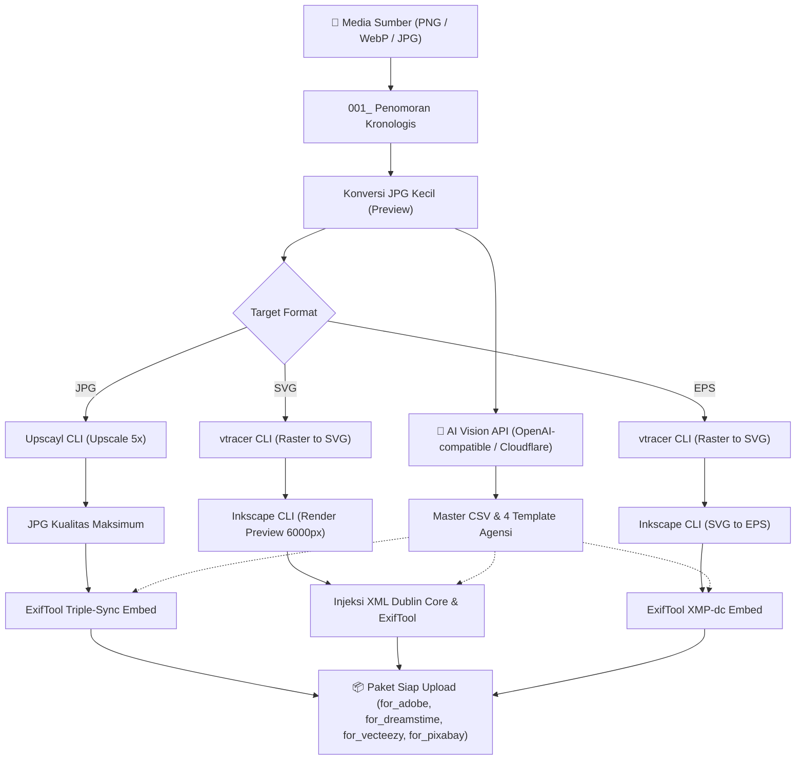

# Microstock Helper

[](https://github.com/alamaby/microstock-helper/releases)
[](https://www.python.org/downloads/)
[](https://www.microsoft.com/windows)
[](LICENSE)
[](tests/)

Aplikasi otomatisasi alur kerja microstock terpadu berbasis Python (CLI) untuk pemrosesan gambar raster, vektorisasi SVG/EPS, generasi metadata AI via Vision API, serta embedding metadata ke format standar agensi (**Adobe Stock**, **Dreamstime**, **Vecteezy**, dan **Pixabay**).

---

## Daftar Isi

- [Alur Kerja (Workflow)](#alur-kerja-workflow)
- [Fitur Utama](#fitur-utama)
- [Prasyarat & Dependensi Eksternal](#prasyarat--dependensi-eksternal)
- [Panduan Instalasi Cepat](#panduan-instalasi-cepat)
- [Diagnosis Kesiapan Sistem](#diagnosis-kesiapan-sistem-doctor)
- [Panduan Penggunaan CLI](#panduan-penggunaan-cli)
  - [1. Orkestrator End-to-End (`run`)](#1-orkestrator-end-to-end-run)
  - [2. Batch Processing Metadata & Embed (`batch`)](#2-batch-processing-metadata--embed-batch)
  - [3. Generasi Metadata AI Mandiri (`generate`)](#3-generasi-metadata-ai-mandiri-generate)
  - [4. Konversi Raster ke JPG (`convert`)](#4-konversi-raster-ke-jpg-convert)
  - [5. Penomoran Kronologis (`renumber`)](#5-penomoran-kronologis-renumber)
  - [6. Upscale Gambar AI (`upscale`)](#6-upscale-gambar-ai-upscale)
  - [7. Tracing Vektor SVG (`trace`)](#7-tracing-vektor-svg-trace)
  - [8. Render Preview Vektor (`vector-preview`)](#8-render-preview-vektor-vector-preview)
  - [9. Konversi SVG ke EPS (`convert-eps`)](#9-konversi-svg-ke-eps-convert-eps)
  - [10. Embed Metadata Gambar (`embed-jpg`)](#10-embed-metadata-gambar-embed-jpg)
  - [11. Embed Metadata Paket Vektor (`embed-vector`)](#11-embed-metadata-paket-vektor-embed-vector)
- [Matriks Format & Ketentuan Agensi](#matriks-format--ketentuan-agensi)
- [Struktur Output Direktori](#struktur-output-direktori)
- [Verifikasi & Pengujian](#verifikasi--pengujian)
- [Lisensi](#lisensi)

---

## Alur Kerja (Workflow)



---

## Fitur Utama

- 🔍 **Startup Preflight Check**: Pemeriksaan dependensi otomatis saat aplikasi dijalankan; mendeteksi ketersediaan seluruh tool CLI eksternal dan API key sebelum pipeline dieksekusi.
- ⚡ **Pillow Native Processing**: Konversi format raster murni (PNG, WebP, TIF, BMP ke JPEG) tanpa proses eksternal berat, lengkap dengan compositing transparansi (alpha) ke latar belakang putih standar industri stock.
- 🧠 **AI Vision Metadata Multi-Tier**: Menghasilkan judul, deskripsi, kata kunci (phrase & single-word), serta kategori resmi agensi menggunakan gateway Vision API lokal dengan failover otomatis ke Cloudflare Workers AI.
- 🔄 **Orkestrator End-to-End & Resume Cerdas**: Alur terpadu multi-tahap (0–7) dengan deteksi file korup/interupsi dan kemampuan me-reuse tahapan yang sudah selesai tanpa memanggil ulang API.
- 🛡️ **Bypass Limit MAX_PATH 260 Karakter**: Proteksi cerdas saat menjalankan Upscayl CLI via sandboxing nama pendek di direktori `%TEMP%`.
- 🏷️ **Triple-Sync ExifTool 2-Phase**: Injeksi metadata bersih (fase reset lalu fase tulis UTF-8) ke IPTC, XMP, dan EXIF untuk memastikan terbaca akurat oleh seluruh portal agensi.

---

## Prasyarat & Dependensi Eksternal

Aplikasi berjalan di lingkungan **Windows** dan memanfaatkan beberapa CLI pendukung:

| Tool CLI | Fungsi Utama | Jalur Pencarian Default |
|---|---|---|
| **Python** (>= 3.10) | Runtime aplikasi & operasi raster Pillow | System `PATH` |
| **ExifTool** | Embed metadata JPG, PNG, dan PostScript EPS | `C:\Apps\exiftool\exiftool.exe` atau `PATH` |
| **Upscayl CLI** | AI Image Upscaling (model `upscayl-standard-4x`) | `C:\Program Files\Upscayl\resources\bin\upscayl-bin.exe` |
| **vtracer CLI** | Konversi raster JPG ke kurva vektor SVG | `C:\Apps\vtracer.exe` atau `PATH` |
| **Inkscape CLI** | Render preview JPG 6000px & konversi SVG ke EPS | `C:\Program Files\Inkscape\bin\inkscape.com` atau `PATH` |
| **ffmpeg / ffprobe** | Utility pendukung video & audio frame extraction | `C:\ProgramData\chocolatey\bin\ffmpeg.exe` atau `PATH` |

> [!NOTE]
> Jika salah satu tool terpasang di direktori non-standar, Anda dapat mengesampingkan lokasinya melalui environment variable:
> - `MICROSTOCK_EXIFTOOL_PATH`
> - `MICROSTOCK_UPSCAYL_PATH`
> - `MICROSTOCK_VTRACER_PATH`
> - `MICROSTOCK_INKSCAPE_PATH`
> - `MICROSTOCK_FFMPEG_PATH`
> - `MICROSTOCK_FFPROBE_PATH`

---

## Panduan Instalasi Cepat

### 1. Setup Virtual Environment Otomatis

Jalankan script setup 1-klik di root direktori untuk menginisialisasi virtual environment dan dependensi Python:

```cmd
setup.bat
```

### 2. Konfigurasi Token API

Salin template lingkungan ke `.env` di root repository:

```cmd
copy .env.example .env
```

Sesuaikan kredensial API Vision Anda pada file `.env`:

```env
# Local / OpenAI-compatible Vision API Gateway (Primary)
MICROSTOCK_API_KEY=kunci_api_vision_anda
MICROSTOCK_API_BASE_URL=http://localhost:8080/v1
MICROSTOCK_API_MODEL=Qwen/Qwen2.5-VL-7B-Instruct

# Cloudflare Workers AI Fallback (Opsional)
MICROSTOCK_CF_ACCOUNT_ID=
MICROSTOCK_CF_API_TOKEN=
```

---

## Diagnosis Kesiapan Sistem (`doctor`)

Jalankan tool diagnosis untuk memastikan seluruh dependensi Python, binary CLI, dan API token telah terdeteksi:

```cmd
run.bat doctor
```

Contoh output kesiapan sistem:

```text
============================================================
  MICROSTOCK SYSTEM DIAGNOSTIC (DOCTOR)
============================================================
  Python                   : OK 3.14.3 (>= 3.10)
  Package PIL              : OK
  Package pydantic         : OK
  Package yaml             : OK

  [External CLI Tools]
  exiftool                 : OK  C:\Apps\exiftool\exiftool.exe
  upscayl                  : OK  C:\Program Files\Upscayl\resources\bin\upscayl-bin.exe
  vtracer                  : OK  C:\Apps\vtracer.EXE
  inkscape                 : OK  C:\Program Files\Inkscape\bin\inkscape.com
  ffmpeg                   : OK  C:\ProgramData\chocolatey\bin\ffmpeg.exe
  ffprobe                  : OK  C:\ProgramData\chocolatey\bin\ffprobe.exe

  [API Key Configuration]
  Local Gateway (Primary)  : OK configured
  Cloudflare AI (Fallback) : OK configured
============================================================
```

---

## Panduan Penggunaan CLI

Seluruh perintah dapat dijalankan melalui launcher `run.bat` di root:

### 1. Orkestrator End-to-End (`run`)

Menjalankan alur penuh dari raw images hingga pemisahan paket agensi siap upload:

```cmd
# Jalur Foto / Raster (JPG) dengan skala upscale 5x
run.bat run "D:\Karya\Batch_01" --target JPG --scale 5

# Jalur Vektor SVG (Adobe, Dreamstime, Pixabay)
run.bat run "D:\Karya\Batch_Vektor" --target SVG

# Jalur Vektor EPS + Preview JPG (Adobe, Dreamstime, Vecteezy, Pixabay)
run.bat run "D:\Karya\Batch_Vektor" --target EPS --preview-width 6000

# Menentukan subset agensi target tertentu:
run.bat run "D:\Karya\Batch_01" --target JPG --platforms Adobe,Dreamstime

# Menyesuaikan nama Creator & Copyright notice:
run.bat run "D:\Karya\Batch_01" --target JPG --copyright "alamaby" --creator "alamaby"

# Force rebuild (memproses ulang seluruh tahap hulu dari awal, abaikan resume):
run.bat run "D:\Karya\Batch_01" --target JPG --force
```

> [!TIP]
> **Fitur Resume Otomatis**: Jika sebuah folder batch sebelumnya telah selesai diproses untuk target JPG, Anda dapat melanjutkan target vektor (SVG atau EPS) pada folder yang sama **tanpa** menyertakan `--force`. Pipeline secara cerdas akan melewati tahap convert & metadata AI (me-reuse CSV yang sudah ada tanpa memanggil API kembali) dan hanya memproses tracing/preview vektor.

---

### 2. Batch Processing Metadata & Embed (`batch`)

Menjalankan alur 3 langkah standar: generate metadata AI -> convert CSV template -> embed metadata ke folder agensi:

```cmd
# Memproses batch untuk Adobe Stock dan Dreamstime sekaligus
run.bat batch "D:\Karya\Batch_01" --agencies both

# Uji coba tanpa menulis file akhir (Dry Run) dengan limit 5 item
run.bat batch "D:\Karya\Batch_01" --agencies adobe --limit 5 --dry-run

# Menimpa output yang sudah ada sebelumnya
run.bat batch "D:\Karya\Batch_01" --agencies both --overwrite
```

---

### 3. Generasi Metadata AI Mandiri (`generate`)

Menjalankan inferensi AI Vision murni untuk menghasilkan master metadata CSV tanpa alur orkestrator:

```cmd
# Generasi metadata untuk seluruh media (gambar / klip video) di direktori
run.bat generate "D:\Karya\Batch_01" --output-dir "D:\Karya\Metadata"

# Membatasi jumlah item dan menimpa metadata yang sudah ada
run.bat generate "D:\Karya\Batch_01" --output-dir "D:\Karya\Metadata" --limit 10 --overwrite
```

---

### 4. Konversi Raster ke JPG (`convert`)

Mengonversi PNG/WebP/BMP/TIF ke JPEG kualitas tinggi dengan alpha compositing latar belakang putih:

```cmd
# Konversi standar kualitas 95
run.bat convert "D:\Karya\RawPNG" --out "D:\Karya\JPG" --quality 95

# Downsampling sisi terpanjang ke 1000px (untuk keperluan preview / small)
run.bat convert "D:\Karya\RawPNG" --out "D:\Karya\JPG_Small" --max-edge 1000

# Menimpa file JPG yang sudah ada di folder tujuan
run.bat convert "D:\Karya\RawPNG" --out "D:\Karya\JPG" --overwrite
```

---

### 5. Penomoran Kronologis (`renumber`)

Mengurutkan file media berdasarkan tanggal pembuatan file lalu memberikan awalan urut `001_...`:

```cmd
# Cek pratinjau rencana rename tanpa mengubah file (Dry Run)
run.bat renumber "D:\Karya\Batch_01" --dry-run

# Eksekusi rename kronologis
run.bat renumber "D:\Karya\Batch_01"
```

---

### 6. Upscale Gambar AI (`upscale`)

Melakukan upscaling gambar secara batch via Upscayl CLI (aman dari batas MAX_PATH 260 karakter):

```cmd
# Upscale 5x (default skala rekomendasi microstock)
run.bat upscale "D:\Karya\JPG_Small" --out "D:\Karya\Upscaled" --scale 5

# Upscale 4x dan timpa hasil yang sudah ada
run.bat upscale "D:\Karya\JPG_Small" --out "D:\Karya\Upscaled" --scale 4 --overwrite
```

---

### 7. Tracing Vektor SVG (`trace`)

Melakukan tracing kurva spline otomatis via vtracer CLI:

```cmd
run.bat trace "D:\Karya\JPG_Small" --out "D:\Karya\SVG"
# Timpa file SVG yang sudah ada
run.bat trace "D:\Karya\JPG_Small" --out "D:\Karya\SVG" --overwrite
```

---

### 8. Render Preview Vektor (`vector-preview`)

Merender SVG menjadi file gambar JPG beresolusi tinggi (default 6000px):

```cmd
run.bat vector-preview "D:\Karya\SVG" --out "D:\Karya\Previews" --width 6000
```

---

### 9. Konversi SVG ke EPS (`convert-eps`)

Mengonversi file SVG ke format PostScript EPS via Inkscape CLI:

```cmd
run.bat convert-eps "D:\Karya\SVG" --out "D:\Karya\EPS"
```

---

### 10. Embed Metadata Gambar (`embed-jpg`)

Menyuntikkan judul, deskripsi, dan kata kunci dari CSV ke file gambar via ExifTool (triple-sync IPTC+XMP+EXIF):

```cmd
# Embed dan salin ke folder output baru
run.bat embed-jpg --csv "D:\Karya\metadata.csv" --images "D:\Karya\JPG" --out "D:\Karya\for_adobe"

# Embed langsung di tempat (in-place) pada folder gambar sumber
run.bat embed-jpg --csv "D:\Karya\metadata.csv" --images "D:\Karya\JPG"
```

---

### 11. Embed Metadata Paket Vektor (`embed-vector`)

Menyuntikkan metadata ke pasangan file vektor (SVG/EPS) dan preview JPG pendamping:

```cmd
# Paket EPS (untuk Adobe Stock, Dreamstime, Vecteezy)
run.bat embed-vector --csv "D:\Karya\metadata.csv" --jpg-dir "D:\Karya\Previews" --vec-dir "D:\Karya\EPS" --out "D:\Karya\for_adobe_eps"

# Paket SVG (untuk Adobe Stock, Dreamstime, Pixabay)
run.bat embed-vector --csv "D:\Karya\metadata.csv" --jpg-dir "D:\Karya\Previews" --vec-dir "D:\Karya\SVG" --out "D:\Karya\for_adobe_svg"
```

---

## Matriks Format & Ketentuan Agensi

| Agensi | Format Diterima | Ketentuan Judul | Format Kata Kunci | Folder Output Paket |
|---|---|---|---|---|
| **Adobe Stock** | JPG, SVG, EPS + JPG | ≤ 70 karakter | Frasa multi-kata, maks 49 kata kunci | `for_adobe/`, `for_adobe_svg/`, `for_adobe_eps/` |
| **Dreamstime** | JPG, SVG + JPG, EPS + JPG | ≤ 200 karakter | Kata tunggal lowercase, maks 70–80 kata | `for_dreamstime/`, `for_dreamstime_svg/`, `for_dreamstime_eps/` |
| **Vecteezy** | JPG (Photo), EPS + JPG | ≤ 70 karakter | Frasa/kata, 5–50 kata kunci, nama file sanitasi FTP | `for_vecteezy_photo/`, `for_vecteezy_eps/` |
| **Pixabay** | JPG, SVG + JPG | ≤ 100 karakter | Frasa/kata, 5–25 kata kunci | `for_pixabay_photo/`, `for_pixabay_svg/` |

> [!NOTE]
> Khusus untuk Vecteezy, nama file disanitasi secara otomatis (menghapus spasi dan simbol khusus) untuk memenuhi standar validasi server upload FTP Vecteezy.

---

## Struktur Output Direktori

Saat pipeline `run` dieksekusi, struktur folder kerja terisolasi dibuat di dalam direktori target:

```text
<SourceDir>/
├── 001_gambar.png                  # File asli (nama diurutkan chronologically)
└── _stock/                         # Folder kerja & paket siap upload
    ├── 01_raw/                     # Salinan cadangan file sumber asli
    ├── 02_jpg_small/               # JPG resolusi rendah untuk inferensi AI & tracing
    ├── 03_metadata/                # Master CSV & 4 template agensi terpisah
    ├── 04_upscaled/                # Hasil upscale AI (jalur JPG)
    ├── 05_final_jpg/               # JPG final resolusi maksimum
    ├── 05_svg/                     # File vektor SVG (jalur SVG/EPS)
    ├── 05_preview_jpg/             # Preview render 6000px
    ├── 06_eps/                     # PostScript EPS (jalur EPS)
    ├── for_adobe/                  # Paket final siap upload Adobe Stock (JPG)
    ├── for_dreamstime/             # Paket final siap upload Dreamstime (JPG)
    ├── for_vecteezy_photo/         # Paket foto ter-sanitasi FTP untuk Vecteezy
    └── for_pixabay_photo/          # Paket foto siap upload Pixabay
```

---

## Verifikasi & Pengujian

Seluruh rangkaian unit tests dan integration tests dapat dijalankan menggunakan `pytest`:

```cmd
.\microstock-metadata-generator\.venv\Scripts\pytest.exe -v tests
```

Untuk menjalankan pengujian modul generator metadata:

```cmd
.\microstock-metadata-generator\.venv\Scripts\pytest.exe -v microstock-metadata-generator\tests
```

---

## Lisensi

Proyek ini dilisensikan di bawah lisensi [MIT](LICENSE).
